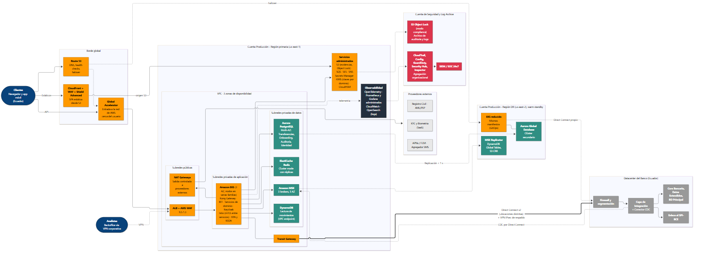

# Consideraciones técnicas

Complementa a [`decisiones-de-diseno.md`](decisiones-de-diseno.md). Los diagramas de referencia son [`infra-aws`](../diagrams/img/infra-aws.png) y los de [`diagrams`](../diagrams).

## 1. Infraestructura cloud y latencia

### Topología

- **Cuentas AWS separadas** (landing zone con Control Tower): producción, no producción, red compartida, seguridad/log archive y auditoría. Las políticas de organización (SCP) impiden desactivar el registro o salir de las regiones autorizadas.
- **Región primaria con tres zonas de disponibilidad** y **región de recuperación** distinta.
- **Conectividad dedicada** al datacenter del banco: dos circuitos Direct Connect en ubicaciones distintas, con VPN IPsec de respaldo, terminados en un Transit Gateway. La región de DR tiene su propio enlace.
- **Subredes** por función: públicas (balanceador y NAT), privadas de aplicación y privadas de datos. Los datos no tienen ruta a Internet. El acceso a servicios AWS se hace por VPC endpoints.
- **Cómputo**: Amazon EKS con nodos en tres zonas, autoescalado horizontal (HPA) y por lag de Kafka (KEDA), PodDisruptionBudgets y topología repartida por zona.
- **Datos**: Aurora PostgreSQL Multi-AZ, ElastiCache Redis con réplicas, MSK de tres brokers, DynamoDB, S3.

### Latencia

El criterio es que la ruta de lectura habitual no dependa de un viaje al Core.

1. **Lecturas desde cloud**: movimientos desde el modelo de lectura, perfil desde caché. El Core solo interviene en saldo (TTL corto) y en operaciones que mueven dinero.
2. **Entrada por la red de AWS**: Global Accelerator y CloudFront hacen que el tráfico del usuario entre al backbone de AWS cerca de su ubicación, no recorra Internet pública hasta la región.
3. **Capa de integración junto al Core**: las conversaciones de varios pasos con el Core ocurren dentro del datacenter. A la WAN cruza una llamada por operación.
4. **Composición en paralelo** en el BFF, con tiempos máximos por dependencia.
5. **Estáticos en el borde**: la SPA se sirve desde CloudFront.

Objetivos propuestos (a validar con pruebas de carga): consultas en caché p95 menor a 150 ms en el servidor; consultas con acceso al Core p95 menor a 500 ms; creación de transferencia (hasta aceptar la solicitud) p95 menor a 1,5 s.

### Elección de región

No hay región de AWS en Ecuador. Hipótesis de trabajo: **us-east-1 (Norte de Virginia)** como primaria y **us-east-2 (Ohio)** como DR, porque el tráfico internacional de Ecuador suele salir por Miami y esa región ofrece el catálogo de servicios más amplio y el menor costo. La alternativa es **sa-east-1 (São Paulo)**, más cercana en geografía pero normalmente más cara y con rutas no siempre mejores desde Ecuador.

La decisión no debe tomarse por suposición: se mide latencia real desde Quito y Guayaquil, con las operadoras que usan los clientes, hacia ambas regiones, y se mide el enlace dedicado disponible hasta el datacenter. Además, hay que confirmar con Legal y con el regulador que se permite alojar datos de clientes fuera del país (ver sección 2); si la respuesta fuese negativa, el diseño se mantiene con una variante: los datos personales permanecen en el datacenter o en un proveedor local y la nube aloja el borde, la composición y los servicios sin datos persistentes.

Alternativas descartadas: todo en el datacenter del banco (sin elasticidad para picos de quincena y sin servicios administrados) y multicloud activo-activo (costo operativo desproporcionado para el tamaño inicial).

## 2. Normativa y cumplimiento

Lista de marcos que deben revisarse. Antes de formalizar el diseño, Cumplimiento y Legal deben confirmar las resoluciones vigentes y su alcance exacto: no se citan números de artículo porque cambian con las reformas.

**Ecuador**

| Marco | Qué implica para el diseño |
|-------|----------------------------|
| Ley Orgánica de Protección de Datos Personales (LOPDP) y su reglamento | Base legal y consentimiento explícito; minimización y finalidad; derechos de acceso, rectificación, eliminación y oposición; datos biométricos como categoría especial; delegado de protección de datos; notificación de brechas a la autoridad y a los afectados; reglas para transferencias internacionales de datos. |
| Código Orgánico Monetario y Financiero | Reserva y sigilo bancario; marco de supervisión de la Superintendencia de Bancos. |
| Normas de control de la Superintendencia de Bancos (gestión de riesgo operativo, seguridad de la información, canales electrónicos y servicios de terceros o en la nube) | Gestión de continuidad, seguridad de canales, controles sobre proveedores, conservación de registros, aprobación o comunicación previa para externalizar procesos. |
| Normativa de prevención de lavado de activos (UAFE) | KYC, debida diligencia, perfil transaccional, reporte de operaciones inusuales y de umbral. La plataforma debe producir los datos para esos reportes. |
| Sistema de pagos del BCE (SPI) | Formatos, horarios, límites y conciliación de las transferencias interbancarias. |
| Ley de Comercio Electrónico, Firmas Electrónicas y Mensajes de Datos | Validez de las operaciones electrónicas y de los registros como prueba. |

**Estándares internacionales**

| Estándar | Aplicación |
|----------|-----------|
| PCI DSS 4.x | Aplica si la plataforma almacena, procesa o transmite datos de tarjeta. Se reduce el alcance: no se guarda el número completo (PAN), se usa tokenización del emisor y se muestra enmascarado. Lo que quede dentro de alcance va en segmentos aislados. |
| ISO/IEC 27001, 27017 y 27018 | Sistema de gestión de seguridad y controles para nube y datos personales en nube. |
| ISO 22301 | Continuidad del negocio. |
| NIST SP 800-63 | Identidad digital y autenticación. |
| OWASP ASVS y MASVS | Verificación de seguridad de aplicaciones web y móviles. |
| FAPI 2.0 | Perfil de seguridad OAuth para servicios financieros. |
| ISO/IEC 30107-3 | Detección de ataques de presentación en biometría. |
| SOC 2 / ISO 27001 de proveedores | Condición para KYC, notificaciones y screening. |

## 3. Alta disponibilidad y tolerancia a fallos

Objetivo propuesto: 99,95 % mensual para consultas y 99,9 % para transferencias, medidos en el canal.

**Eliminar puntos únicos.** Tres zonas de disponibilidad en cómputo, Aurora, MSK y Redis. Dos circuitos de conectividad. Balanceadores y gateway sin estado.

**Degradar con criterio, no caer.**

| Falla | Comportamiento |
|-------|----------------|
| Core no disponible | Consultas desde modelo de lectura y caché con aviso de antigüedad. Transferencias deshabilitadas con mensaje claro. Notificaciones y auditoría continúan con lo ya recibido. |
| SPI no disponible | Las transferencias propias y a terceros del banco siguen. Las interbancarias se rechazan antes de reservar fondos, o quedan en cola con consentimiento del cliente. |
| Datos extendidos no disponibles | Se devuelve el perfil básico con un indicador de datos incompletos. |
| Redis caído | Se consulta la fuente directamente con límite de tasa para no saturar el Core. |
| Proveedor de KYC caído | El onboarding queda en espera; no afecta a clientes existentes. Se puede conmutar al segundo proveedor. |
| Proveedor de SMS o push caído | La cadena de notificación escala al siguiente canal. |
| Kafka degradado | Los servicios siguen operando; el outbox acumula eventos y los publica al recuperar. |

**Patrones de resiliencia.** Tiempos máximos en toda llamada, circuit breaker, bulkhead por dependencia, reintentos con backoff y jitter solo en operaciones idempotentes, idempotencia en transferencias y consumidores, limitación de tasa, apagado ordenado y probes de salud.

**Despliegue seguro.** Despliegues graduales (canary), reversión automática por métricas, migraciones de base de datos compatibles hacia atrás, feature flags.

**Pruebas de falla.** Pruebas de caos con AWS Fault Injection Service (caída de zona, latencia al Core, pérdida de un broker) en preproducción de forma continua y en producción como ejercicios planificados.

## 4. Recuperación ante desastres

| Nivel | Servicios | RTO | RPO |
|-------|-----------|-----|-----|
| 1 | Transferencias, identidad, auditoría, notificaciones | 30 minutos | 1 minuto o menos |
| 2 | Consultas (clientes, movimientos), onboarding | 60 minutos | 5 minutos |
| 3 | Backoffice, reportes | 4 horas | 1 hora |

Son objetivos propuestos para discutir con el negocio. Se definen por impacto, no por tecnología.

**Estrategia: warm standby** en la segunda región, con capacidad reducida y listo para escalar.

| Componente | Mecanismo |
|------------|-----------|
| Aurora | Aurora Global Database con clúster secundario |
| Kafka | MSK Replicator |
| DynamoDB | Global Tables |
| S3 | Replicación entre regiones, Object Lock |
| Caché | No se replica: se reconstruye (es desechable) y se precarga con el detector de clientes frecuentes |
| Infraestructura y aplicaciones | Terraform y GitOps; los mismos manifiestos en ambas regiones |
| Tráfico | Route 53 con health checks y Global Accelerator |
| Conectividad al Core | Circuito propio hacia la región de DR |

**Respaldos.** AWS Backup con copia entre regiones y entre cuentas y bóveda con bloqueo; recuperación a un punto en el tiempo en Aurora; retención según política. Los respaldos se prueban: restauración automática mensual y ejercicio completo de DR cada seis meses con medición del RTO real.

**Failover.** Procedimiento documentado y ensayado. La promoción de la región secundaria es una decisión humana con criterios definidos, para evitar conmutaciones por falsos positivos. El estado de transferencias en vuelo se resuelve con el conciliador al reanudar.

El DR del Core y de la base principal es responsabilidad del banco. Debe alinearse con los RTO/RPO de esta plataforma, porque la disponibilidad de las transferencias nunca será mayor que la de ese Core.

## 5. Seguridad y monitoreo

### Protección de datos

| Aspecto | Medida |
|---------|--------|
| En tránsito | TLS 1.3 de cara al usuario; mTLS entre servicios (malla Istio); IPsec o MACsec en los enlaces al datacenter; certificate pinning en móvil. |
| En reposo | Cifrado en todos los almacenes con claves de KMS por dominio de datos y rotación; claves de alto valor en CloudHSM. |
| Datos sensibles | Cifrado a nivel de campo con encriptación de sobre para cédula, teléfono y correo; tokenización de números de cuenta cuando salen del dominio; enmascarado en logs, notificaciones y consolas. |
| Secretos | Secrets Manager con rotación; ninguno en imágenes ni repositorios. |
| Minimización | Solo se almacena lo necesario; retención y borrado por política (en especial imágenes de onboarding). |

### Seguridad de la plataforma

- **Perímetro**: AWS WAF (reglas OWASP, control de bots), Shield Advanced, limitación de tasa en el gateway.
- **Red**: segmentación por subredes y políticas de red de Kubernetes; sin acceso directo a datos desde Internet.
- **Identidad de la carga**: roles IAM por cuenta de servicio (IRSA), mínimo privilegio, sin credenciales de larga duración.
- **Cadena de suministro**: análisis estático y de dependencias, escaneo de imágenes, SBOM, firma de imágenes y política de admisión que rechaza lo no firmado.
- **Pruebas**: análisis dinámico, pruebas de intrusión externas antes de cada salida mayor y cada año, revisión de configuración con CIS Benchmarks.
- **Acceso humano**: acceso a producción por sesiones temporales y aprobadas, registradas, sin acceso permanente.
- **App móvil**: atestación de integridad, detección de root y de depuración, protección de código.

### Monitoreo continuo

- **Observabilidad**: OpenTelemetry para trazas, métricas y logs con un identificador de correlación que viaja desde el canal hasta el Core. Prometheus y Grafana administrados, CloudWatch y OpenSearch para logs.
- **Indicadores**: señales de oro (latencia, tráfico, errores, saturación) por servicio, tasa de transferencias fallidas o en conciliación, lag de consumidores Kafka, tasa de acierto de caché, tiempo de respuesta del Core y del SPI, tasa de entrega de notificaciones.
- **SLO y alertas** por consumo del presupuesto de error, con escalamiento hacia guardia.
- **Seguridad**: GuardDuty, Security Hub, Inspector, Config y CloudTrail agregados en la cuenta de seguridad y enviados al SIEM del SOC 24x7. Reglas de detección para anomalías de autenticación, picos de transferencias y cambios de configuración.
- **Fraude**: señales del motor antifraude y analítica de comportamiento enviadas al mismo SOC.
- **Respuesta a incidentes**: plan documentado, con el tiempo de notificación a la autoridad que fije la normativa.

## 6. Escalabilidad y desacoplamiento

**Escalar.** Servicios sin estado, escalado horizontal por CPU y por lag de colas; particionado de Kafka por cliente o cuenta; DynamoDB bajo demanda; Aurora con réplicas de lectura. Cada servicio escala de forma independiente: la quincena presiona a Transferencias y Notificaciones, no a Onboarding.

**Agregar componentes sin romper lo existente.**

| Mecanismo | Efecto |
|-----------|--------|
| Eventos con esquemas versionados (Avro o Protobuf con registro de esquemas y compatibilidad hacia atrás) | Un consumidor nuevo (analítica, prevención de fraude, programa de fidelización) se suscribe sin tocar a los productores. |
| Contratos primero: OpenAPI y AsyncAPI, con pruebas de contrato (Pact) | Los equipos cambian de forma independiente y la compatibilidad se verifica en la integración continua. |
| Estrategias registradas por tipo | Un nuevo tipo de transferencia o canal de notificación es una clase nueva y una línea de configuración. |
| Puertos y adaptadores (arquitectura hexagonal) | Se cambia de proveedor o de Core sin tocar el dominio. |
| Versionado de API en el gateway | Convivencia de versiones y retiro planificado. |
| Una base de datos por servicio | Cada equipo evoluciona su esquema sin coordinar con otros. |
| Feature flags y canary | Se libera funcionalidad apagada y se activa por segmentos. |

El límite de este modelo es la consistencia eventual: las vistas derivadas (movimientos en el modelo de lectura, notificaciones) se retrasan algunos segundos respecto al Core. Se acepta de forma consciente y se muestra al usuario cuando importa (hora de consulta del saldo).
