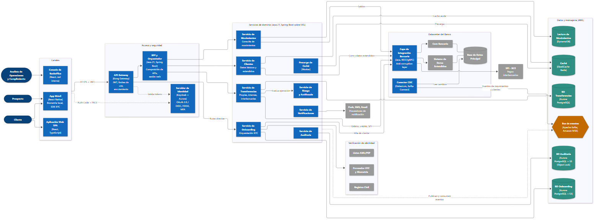

# Plataforma de Banca Digital: decisiones de diseño

Este documento recoge las decisiones de arquitectura y su justificación. Los diagramas están en [`../diagrams`](../diagrams) y las consideraciones transversales (normativa, disponibilidad, DR, seguridad, escalabilidad, cloud) en [`consideraciones-tecnicas.md`](consideraciones-tecnicas.md).

## 1. Punto de partida y supuestos

El enunciado deja varios datos abiertos. Estos son los supuestos con los que se diseñó; si alguno cambia, se indica qué decisión se ve afectada.

| # | Supuesto | Si no se cumple |
|---|----------|-----------------|
| S1 | El Core Bancario, el sistema de datos extendidos y la base de datos principal seguirán en el datacenter del banco y son el sistema de registro. | Si se migran a cloud, desaparece la capa de réplica por CDC y baja la latencia de escritura. |
| S2 | El Core expone operaciones transaccionales (consulta, reserva, débito, crédito) por API, SOAP o mensajería. No se conoce el producto concreto. | La capa de integración absorbe la diferencia; el resto del diseño no cambia. |
| S3 | La base de datos principal permite captura de cambios (CDC) sobre movimientos y clientes, o el DBA acepta una réplica de lectura. | Se sustituye por consulta directa al Core con caché más agresiva (fase 1, ver sección 7). |
| S4 | Las transferencias interbancarias salen por el Sistema de Pagos Interbancarios del BCE (SPI), a través de un enlace que ya posee el banco. | Cambia solo el adaptador SPI. |
| S5 | El banco tiene un SOC o contrata uno, y un equipo que opera Kubernetes. | Si no lo tiene, se prefieren servicios totalmente administrados (ver alternativas en cada decisión). |
| S6 | Volumen inicial de referencia: 500 mil clientes digitales, 50 mil usuarios concurrentes en horas pico, 150 transferencias por segundo en picos de quincena. Son cifras de dimensionamiento, no del enunciado. | Se reajusta el tamaño de los clústeres; la topología se mantiene. |

## 2. Resumen de decisiones

| Tema | Decisión | Alternativa descartada | Motivo principal |
|------|----------|------------------------|------------------|
| Arquitectura | Microservicios por capacidad de negocio, orientados a eventos, sobre Kubernetes | Monolito modular | Escalado independiente de transferencias y consultas, y despliegues sin ventana. |
| Entrada | Kong Gateway (borde) + BFF/orquestador (composición) | Amazon API Gateway solo | Portabilidad, plugins de seguridad y orquestación fuera del gateway. |
| Identidad | Keycloak como servidor OAuth 2.0 / OIDC | Amazon Cognito, Auth0 | Control del flujo de autenticación, FIDO2 y extensibilidad para biometría. |
| Flujo OAuth | Authorization Code + PKCE, con PAR y tokens ligados al dispositivo (DPoP) | Implicit, Password Grant | Son los recomendados para clientes públicos; los otros están desaconsejados. |
| KYC y biometría | Proveedor regional con SDK embebido, abstraído tras un puerto | Construir reconocimiento facial propio | Detección de ataques de presentación certificada y menor tiempo de salida. |
| Integración con Core | Capa anticorrupción en el datacenter del banco | Que cada servicio hable con el Core | Aísla el protocolo del Core y limita llamadas por la WAN. |
| Datos de lectura | Modelo de lectura alimentado por CDC (CQRS) + caché | Consultar siempre al Core | Latencia y carga sobre el Core. |
| Transferencias | Saga orquestada con idempotencia y conciliación | Transacción distribuida (2PC) | No existe coordinador transaccional entre Core, SPI y nuestros servicios. |
| Mensajería | Kafka (MSK) para eventos y SQS para colas de trabajo | Solo colas | Varios consumidores independientes y reproducción de eventos. |
| Auditoría | PostgreSQL de solo inserción con cadena de hashes + archivo S3 Object Lock | Amazon QLDB | QLDB está en fin de soporte. |
| Caché | Redis, patrón cache-aside con precarga para clientes frecuentes | Caché en memoria por instancia | Consistencia entre réplicas e invalidación por evento. |
| Frontend | React + React Native (opción A) | Angular + Flutter (opción B) | Código compartido, disponibilidad de talento, ecosistema de seguridad móvil. |
| Cloud | AWS, región primaria en Norteamérica, DR en otra región, conectividad dedicada al datacenter | Todo on-premise | Elasticidad y servicios administrados; el Core permanece en el país. |

## 3. Capa de integración

### 3.1 API Gateway y orquestación

Se separan dos responsabilidades que suelen mezclarse:

- **API Gateway (Kong).** Resuelve lo que es común a todas las llamadas: validación del token, límites de uso, protección ante abuso, versionado, correlación de trazas. No contiene lógica de negocio.
- **BFF y orquestador.** Compone respuestas que necesitan varios servicios (por ejemplo, la pantalla de inicio: datos del cliente, saldos y últimos movimientos en una sola llamada), ejecuta las llamadas en paralelo con tiempos máximos y devuelve respuesta parcial si un servicio falla. También mantiene la sesión de la SPA (ver 4.2).

La orquestación vive en el BFF y no en el gateway porque la lógica de composición cambia con cada pantalla y debe versionarse, probarse y desplegarse como cualquier otro servicio.

### 3.2 Servicios

Los tres que pide el enunciado:

1. **Servicio de Clientes**: datos del cliente. Combina datos básicos (Core) y extendidos en un único modelo.
2. **Servicio de Movimientos**: consulta de movimientos y saldos.
3. **Servicio de Transferencias**: propias, a terceros del banco e interbancarias. Elige el procesador según el tipo (patrón Strategy) y llama al servicio externo correspondiente: Core para las internas, SPI para las interbancarias. Una transferencia internacional (SWIFT) sería un cuarto procesador, sin tocar los existentes.

Servicios adicionales y por qué:

| Servicio | Justificación |
|----------|---------------|
| Onboarding | El registro con reconocimiento facial es un proceso con estado, pasos externos y revisión manual; no encaja en ningún otro servicio. |
| Notificaciones | La norma exige avisar cada movimiento. Debe reaccionar a eventos del Core, no solo a lo iniciado en la app. |
| Auditoría | Requisito explícito, con separación de funciones respecto a los servicios que audita. |
| Riesgo y Antifraude | Límites, perfilado y decisión de autenticación reforzada. Se desacopla para evolucionar reglas sin desplegar Transferencias. |
| Precarga de Caché | Proceso en segundo plano con ciclo de vida distinto al de las APIs. |
| Capa de Integración Bancaria | Anticorruption layer: traduce el modelo y protocolo del Core al modelo del dominio digital. Se ubica en el datacenter del banco, junto al Core, para que las conversaciones de varios pasos no crucen la WAN. |

Cada servicio tiene su propia base de datos. Ningún servicio lee la base de otro; se comunican por API o por eventos.

## 4. Autenticación y autorización

### 4.1 Flujo OAuth recomendado

**Authorization Code con PKCE** (RFC 7636), para la SPA y para la app móvil, siguiendo las prácticas de OAuth 2.1 y el perfil FAPI 2.0 en lo que aplica a banca.

Por qué este y no otro:

- *Implicit*: entrega el token en la URL; está retirado en OAuth 2.1.
- *Resource Owner Password Credentials*: la app maneja la contraseña del usuario y no permite MFA ni biometría en el servidor de identidad. Retirado en OAuth 2.1.
- *Client Credentials*: se usa únicamente entre servicios (con mTLS), nunca para usuarios.

Complementos que se incluyen:

| Elemento | Decisión |
|----------|----------|
| Cliente móvil | Navegador del sistema (`ASWebAuthenticationSession` / Custom Tabs), según RFC 8252. No se usa WebView embebido. |
| Cliente web | Patrón BFF: el BFF es el cliente OAuth confidencial, guarda los tokens en servidor y entrega al navegador una cookie `HttpOnly`, `Secure`, `SameSite`. El navegador nunca ve un token. |
| PAR (RFC 9126) | Los parámetros de autorización viajan por canal seguro, no por la URL. |
| DPoP (RFC 9449) | El access token queda ligado a la clave del dispositivo; un token robado no sirve en otro equipo. Si la versión de Keycloak o del gateway no lo soporta de forma estable, se usa mTLS ligado a certificado (RFC 8705) como alternativa. |
| Duración de tokens | Access token: 5 minutos. Refresh token con rotación y detección de reutilización. Inactividad web: 5 minutos. |
| Autenticación reforzada (step-up) | Las operaciones sensibles (transferir, agregar beneficiario, cambiar datos de contacto) exigen un `acr` elevado: confirmación biométrica y firma con la clave del dispositivo. Se responde `401` con `insufficient_user_authentication` y la app dispara el reto. |
| Scopes | `accounts:read`, `transfers:create`, `profile:write`, etc. El gateway verifica scope y `acr` por ruta. |

Detalle del flujo: [`flujo-login`](../diagrams/img/flujo-login.png).

### 4.2 Servidor de identidad

Keycloak (distribución de Red Hat o comunidad con soporte), desplegado en el clúster con base de datos propia. Se eligió por tres razones: soporta OIDC y los perfiles de seguridad exigidos, soporta WebAuthn/passkeys, y permite escribir autenticadores propios (registro de dispositivo, evaluación de riesgo) sin depender de un proveedor.

Alternativas valoradas:

- *Amazon Cognito*: menos operación, pero limita los flujos personalizados de step-up y el registro de dispositivos.
- *Auth0 / Okta CIAM*: buena opción si el banco prefiere un SaaS y acepta el costo por usuario activo; el diseño no cambiaría, solo el contenedor del IdP.

### 4.3 KYC y biometría

La biometría aparece en dos momentos distintos y con herramientas distintas:

| Momento | Qué se verifica | Herramienta recomendada |
|---------|-----------------|-------------------------|
| Onboarding (identidad) | Autenticidad del documento, prueba de vida, similitud entre selfie y foto del documento | Proveedor KYC con SDK móvil: Incode o Metamap (presencia regional); Onfido o Jumio como alternativas globales. Alternativa de menor costo y mayor trabajo propio: AWS Rekognition Face Liveness + Textract. |
| Acceso (autenticación) | Que quien abre la app es el titular del dispositivo registrado | Biometría local del sistema operativo (Face ID, huella, BiometricPrompt) que desbloquea una clave en Secure Enclave / StrongBox. Passkeys (WebAuthn) en web. |
| Cumplimiento | Sanciones, PEP, listas restrictivas | Servicio de screening (ComplyAdvantage, LSEG World-Check o Dow Jones, según contrato) |
| Fraude | Comportamiento y riesgo del dispositivo | BioCatch o LexisNexis ThreatMetrix; Play Integrity y App Attest para integridad de la app |
| Protección de la app | Root/jailbreak, manipulación, hooking | RASP (Guardsquare, Appdome o Talsec) |

Criterios para elegir proveedor KYC, a verificar en una prueba de concepto antes de contratar: certificación de detección de ataques de presentación (ISO/IEC 30107-3), tasas de falsos rechazos con cédulas ecuatorianas reales, posibilidad de validar contra el Registro Civil, tiempo de respuesta desde Ecuador, residencia de los datos y precio por verificación. Por eso el proveedor queda detrás de un puerto (patrón Adapter): cambiarlo no afecta al resto.

Dato biométrico: el patrón de huella o rostro de los accesos nunca sale del dispositivo; el servidor solo recibe una firma criptográfica. Las imágenes de onboarding las conserva el proveedor o el banco bajo política de retención explícita, por ser dato sensible según la ley de protección de datos.

## 5. Onboarding digital

Flujo completo en [`flujo-onboarding`](../diagrams/img/flujo-onboarding.png). Puntos clave:

1. Consentimiento informado antes de capturar nada, con versión del texto y fecha.
2. Verificación de teléfono y correo con OTP.
3. Captura de cédula y selfie con prueba de vida usando el SDK del proveedor. Las imágenes van del dispositivo al proveedor, sin pasar por servidores del banco.
4. El resultado se obtiene del proveedor de servidor a servidor. No se confía en el resultado que reporte la app.
5. Validación contra Registro Civil y screening AML/PEP.
6. Motor de decisión con umbrales configurables: aprueba, rechaza o envía a revisión manual.
7. Alta del cliente en el Core, creación del usuario en el IdP, definición de contraseña y activación de biometría del dispositivo.

**Acceso posterior al onboarding.** Usuario y contraseña como credencial de base (política de contraseñas según NIST SP 800-63B, sin reglas de composición arbitrarias, con verificación contra contraseñas filtradas y bloqueo progresivo). Sobre eso, el dispositivo queda vinculado y el usuario puede entrar con huella o rostro. En web, passkeys como alternativa. El SMS no se usa como segundo factor principal por su exposición a intercambio de SIM; queda como último recurso de recuperación.

El proceso se modela como saga con máquina de estados: si falla un paso intermedio (por ejemplo, el alta en el Core funcionó pero el IdP no respondió), se reintenta o se compensa, y el caso queda visible para el equipo de operaciones.

## 6. Notificaciones

La norma exige informar cada movimiento. Dos consecuencias de diseño:

- **El disparador es el movimiento en el Core, no la acción en la app.** Retiros en cajero, pagos con tarjeta o débitos automáticos también deben notificarse. Por eso el servicio consume eventos de movimientos generados por CDC sobre la base principal.
- **Garantía de entrega razonable, no de entrega exacta.** Un evento puede llegar más de una vez; la idempotencia por (movimiento, canal) evita avisos duplicados.

Canales:

| Canal | Rol | Implementación |
|-------|-----|----------------|
| Push | Principal: inmediato, costo marginal bajo, con detalle | APNs y FCM |
| SMS | Respaldo universal: llega sin datos ni app instalada | Agregador local con operadoras ecuatorianas, y un proveedor global de respaldo |
| Email | Constancia y estados de cuenta | Amazon SES |
| In-app | Historial dentro de la app | WebSocket o SSE |

Se cumple el mínimo de dos canales con Push + SMS como obligatorios. La cadena es: Push; si no hay acuse de entrega en un tiempo configurable, SMS; email como constancia. El cliente puede añadir canales, pero no desactivar los mínimos regulatorios. Los mensajes enmascaran cuentas y no incluyen datos que permitan una acción por sí solos.

Fallas: los envíos fallidos van a una cola de reintentos con backoff y una cola de mensajes muertos con alerta. Cada entrega queda registrada y se publica a auditoría.

## 7. Auditoría y caché

### 7.1 Base de datos de auditoría

Registra todas las acciones del cliente: autenticación, consultas, creación de transferencias, cambios de perfil, y también lo que se le niega.

Diseño:

- Los servicios y el gateway emiten eventos de auditoría al bus. Las acciones que modifican estado lo hacen mediante outbox, dentro de la misma transacción; las lecturas, de forma asíncrona.
- El Servicio de Auditoría valida el evento, lo enriquece (dispositivo, IP, geolocalización, identificador de traza), calcula un hash que incluye el del registro anterior y lo inserta.
- Almacenamiento en dos niveles: PostgreSQL (Aurora), con tabla de solo inserción y particiones mensuales para consulta reciente; y archivo en S3 en formato Parquet con Object Lock en modo compliance, en una cuenta AWS distinta, para retención larga y consulta con Athena.
- Los registros incluyen: quién, qué, sobre qué recurso, cuándo, desde dónde, resultado, identificador de correlación y el hash. El cuerpo se guarda sin datos sensibles en claro.
- La consulta se hace por API con control de acceso por rol, y cada consulta queda también auditada.

Por qué una base separada: separación de funciones (quien opera las transferencias no puede modificar su rastro), tolerancia a la carga de escritura y evidencia de que no hubo manipulación. La cadena de hashes permite detectar alteraciones; el Object Lock impide borrar el archivo aunque se comprometa la cuenta de aplicación.

El plazo de retención debe fijarlo Cumplimiento con base en la normativa; el diseño lo soporta por política de ciclo de vida.

### 7.2 Caché para clientes frecuentes

Componentes (ver [diagrama](../diagrams/img/c4-3-componentes-clientes-cache.png)):

| Componente | Patrón | Función |
|-----------|--------|---------|
| Repositorio con caché | Decorator sobre el repositorio real, cache-aside | Mira primero Redis; si no está, consulta la fuente y almacena. |
| Protección ante avalancha | Single-flight por clave, TTL con jitter, negative caching | Evita que mil solicitudes simultáneas por una clave vencida golpeen el Core. |
| Detector de clientes frecuentes | Contador por ventana deslizante en Redis (sorted set) | Mide accesos a partir de eventos de login. |
| Política de frecuencia | Estrategia configurable | Define quién es "frecuente": por ejemplo, Top-N o cinco o más accesos en siete días. |
| Precargador (cache warmer) | Pre-fetch | Al detectar un login de cliente frecuente, o antes de picos conocidos (quincena, fin de mes), carga perfil, productos y últimos movimientos. |
| Consumidor e invalidador | Observer / publish-subscribe | Elimina o refresca claves al recibir `cliente.actualizado` o `movimiento.registrado`. |
| Repositorio remoto con resiliencia | Repository + Circuit Breaker | Si el Core falla, sirve el dato en caché marcado con su antigüedad. |

Reglas por tipo de dato:

| Dato | TTL | Invalidación | Nota |
|------|-----|--------------|------|
| Perfil y datos extendidos | 30 min (frecuentes), 5 min (resto) | Por evento | Cifrado de campos sensibles dentro de la caché. |
| Productos y cuentas | 15 min | Por evento | |
| Últimos movimientos | 60 s | Por evento | Complementa el modelo de lectura. |
| Saldo | 10 s | Por evento | Se muestra con su hora de consulta. |
| Validaciones para transferir | No se cachea | n/a | Cualquier decisión que mueva dinero va al Core. |

**Fase 1 sin CDC (supuesto S3).** Si no se obtiene CDC, el Servicio de Movimientos consulta el Core con la misma caché y TTL cortos, y las notificaciones se alimentan de una cola que el Core publique. Es funcional pero con más carga sobre el Core y menos inmediatez.

## 8. Frontend: dos opciones

La plataforma requiere SPA web y app móvil multiplataforma. Se comparan dos stacks completos.

### Opción A: React + React Native (monorepo TypeScript)

- Web: React 18, TypeScript, Vite, TanStack Query, componentes propios con un sistema de diseño.
- Móvil: React Native (con módulos nativos para KYC, biometría y almacenamiento seguro).
- Compartido en el monorepo (Nx o Turborepo): tipos y cliente de API generados desde OpenAPI, validaciones (Zod), tokens de diseño, lógica de negocio sin UI. Estimación razonable de código compartido: entre 40 y 60 %, no en la interfaz sino en la lógica.
- Pruebas: Vitest/Jest, Playwright (web), Detox (móvil).

### Opción B: Angular + Flutter

- Web: Angular, TypeScript, RxJS, Angular Material o librería propia.
- Móvil: Flutter (Dart), con `local_auth` y `flutter_secure_storage`.
- Dos bases de código separadas, contrato común por OpenAPI.

### Comparación

Puntuación de 1 a 5, con el peso entre paréntesis. Es una valoración del autor para esta situación, no un dato objetivo.

| Criterio | A: React + RN | B: Angular + Flutter |
|----------|:-------------:|:--------------------:|
| Reutilización entre web y móvil (20 %) | 4 | 2 |
| Disponibilidad de talento en el mercado local (20 %) | 5 | 3 |
| Ecosistema de seguridad móvil y SDK de proveedores KYC/RASP (20 %) | 5 | 4 |
| Rendimiento y consistencia visual del móvil (15 %) | 3 | 5 |
| Estructura y mantenibilidad a escala (15 %) | 3 | 5 |
| Accesibilidad y CSP estricta en web (10 %) | 4 | 4 |
| **Total ponderado** | **4,1** | **3,7** |

**Selección: opción A.** Pesa más la capacidad de compartir lógica y contratos entre web y móvil, la facilidad de contratar y reemplazar personas, y que los proveedores de KYC, biometría y protección de apps entregan SDK y wrappers de primera línea para React Native. Los puntos débiles de A (rendimiento del puente, disciplina arquitectónica) se mitigan con la arquitectura nueva de React Native, reglas de módulos del monorepo (Nx boundaries) y una guía de arquitectura de frontend.

La opción B sería mi elección si el banco ya tuviera equipos Angular consolidados o si el diseño móvil fuera el diferenciador principal. Una variante, Flutter para web y móvil con un solo código, se descartó para la web por tamaño de carga inicial, accesibilidad y las restricciones que impone a una política CSP estricta.

Requisitos comunes: WCAG 2.1 AA, internacionalización, política CSP estricta, SRI en estáticos, sin secretos en el cliente, certificate pinning y detección de root en móvil, telemetría de errores sin datos personales.

## 9. Patrones de diseño aplicados

| Patrón | Dónde | Para qué |
|--------|-------|----------|
| API Gateway | Kong | Punto de entrada único y controles transversales |
| Backend for Frontend | BFF | Respuestas ajustadas a cada canal y sesión web segura |
| API Composition | Orquestador | Unir datos de varios servicios en una llamada |
| Anti-Corruption Layer | Capa de Integración | Aislar el modelo del Core |
| Adapter | Core, SPI, KYC, AML, Registro Civil | Cambiar un proveedor sin tocar el dominio |
| Strategy + Factory | Tipos de transferencia, canales de notificación, proveedor KYC | Agregar variantes sin modificar lo existente |
| Saga orquestada + máquina de estados | Transferencias interbancarias, onboarding | Consistencia sin transacciones distribuidas |
| Transactional Outbox + CDC | Todos los que publican eventos | No perder ni duplicar eventos respecto al estado guardado |
| CQRS (modelo de lectura) | Movimientos | Separar consulta de operación, aliviar el Core |
| Cache-Aside + Decorator | Servicio de Clientes | Caché transparente para el resto del código |
| Circuit Breaker, Bulkhead, Retry con backoff | Llamadas al Core, SPI y proveedores | Contener fallas parciales |
| Idempotent Receiver | Transferencias y consumidores de eventos | Tolerar reintentos y duplicados |
| Publish/Subscribe | Bus de eventos | Desacoplar productores de consumidores |
| Chain of Responsibility | Fallback de canales de notificación | Escalar de push a SMS a email |
| Repository | Acceso a datos de cada servicio | Aislar persistencia |

## 10. Riesgos y puntos abiertos

| Riesgo o duda | Mitigación |
|---------------|------------|
| Latencia entre cloud y el Core por la WAN | Capa de integración junto al Core, modelo de lectura y caché en cloud, pocas llamadas por pantalla. Se mide en una prueba de concepto antes de fijar región. |
| El Core no soporta CDC o tiene límite de conexiones | Fase 1 descrita en 7.2; acordar con el equipo del Core los límites de capacidad. |
| Dependencia de un proveedor de KYC | Puerto Adapter, prueba de concepto con dos proveedores, cláusulas de salida. |
| Residencia de datos y uso de nube | Validar con Legal y con la Superintendencia de Bancos. Ver `consideraciones-tecnicas.md`. |
| Operar Kubernetes, Kafka y Keycloak requiere equipo especializado | Servicios administrados (EKS, MSK, Aurora) y, si hace falta, IdP como servicio. |
| Duplicidad de notificaciones por reintentos | Idempotencia por movimiento y canal. |
| Estado incierto de una transferencia ante un timeout del SPI | Estado `EN_CONCILIACION`, consulta activa y conciliación diaria; nunca se asume fallo. |
